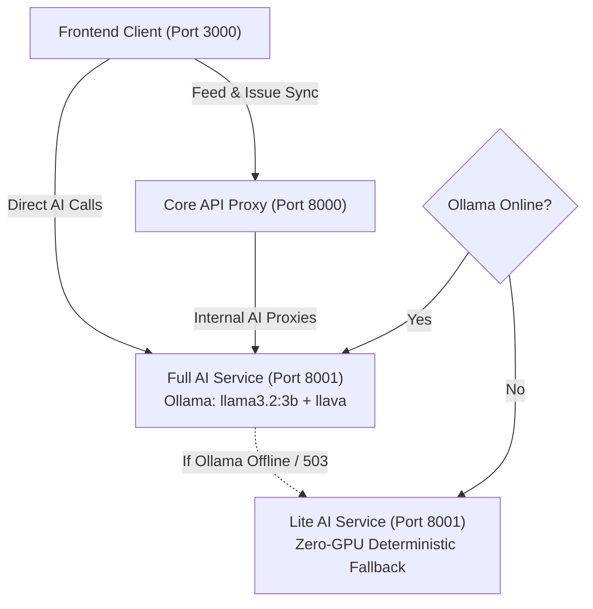
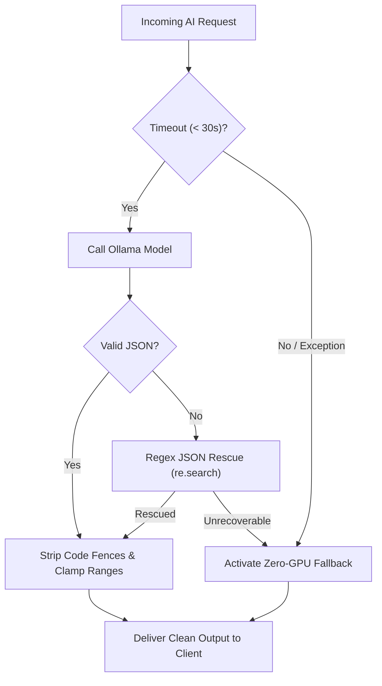

# JanSevak (PrajaPulse) — AI Features & Intelligence Architecture

**A comprehensive, deep-dive technical guide to every Artificial Intelligence system, machine learning model, vision pipeline, and predictive algorithm powering the JanSevak platform.**

---

## Table of Contents

1. [AI Design Philosophy & Core Principles](#1-ai-design-philosophy--core-principles)
2. [AI Architecture & Dual-Engine Strategy](#2-ai-architecture--dual-engine-strategy)
   - [Full Engine (Ollama + GPU Acceleration)](#full-engine-ollama--gpu-acceleration)
   - [Lite Fallback Engine (Zero-GPU Offline Intelligence)](#lite-fallback-engine-zero-gpu-offline-intelligence)
   - [Model Management & Defensive Pipeline](#model-management--defensive-pipeline)
3. [Exhaustive Breakdown of All AI Features](#3-exhaustive-breakdown-of-all-ai-features)
   - [Feature 1: Multi-Lingual Civic Chatbot ("PrajaPulse AI")](#feature-1-multi-lingual-civic-chatbot-prajapulse-ai)
   - [Feature 2: Auto-Draft Complaint from Photo (Vision Intelligence)](#feature-2-auto-draft-complaint-from-photo-vision-intelligence)
   - [Feature 3: Photo Relevance & Civic Safety Classifier](#feature-3-photo-relevance--civic-safety-classifier)
   - [Feature 4: "Draft with AI" / Problem Description Polisher](#feature-4-draft-with-ai--problem-description-polisher)
   - [Feature 5: Formal Administrative Complaint Letter Generator](#feature-5-formal-administrative-complaint-letter-generator)
   - [Feature 6: Hazard Detection & Severity Evaluator](#feature-6-hazard-detection--severity-evaluator)
   - [Feature 7: Suggestive Remarks & Action Recommendations](#feature-7-suggestive-remarks--action-recommendations)
   - [Feature 8: Feed Criticality & Urgency Prioritization Engine](#feature-8-feed-criticality--urgency-prioritization-engine)
   - [Feature 9: 7:00 AM Daily City Briefing AI Prioritizer](#feature-9-700-am-daily-city-briefing-ai-prioritizer)
   - [Feature 10: Positive Impact Reel & Resolution Verifier](#feature-10-positive-impact-reel--resolution-verifier)
   - [Feature 11: Predictive Civic Alerts & Municipal Dataset Synthesis](#feature-11-predictive-civic-alerts--municipal-dataset-synthesis)
   - [Feature 12: Street-Level Predictive Risk Assessment Tool](#feature-12-street-level-predictive-risk-assessment-tool)
4. [Civic Datasets & Ground Truth Integration](#4-civic-datasets--ground-truth-integration)
5. [Defensive AI Engineering & Error Recovery](#5-defensive-ai-engineering--error-recovery)
6. [API Reference & Endpoint Summary](#6-api-reference--endpoint-summary)

---

## 1. AI Design Philosophy & Core Principles

Artificial Intelligence in JanSevak is designed under three strict civic engineering principles:

1. **Augmentation, Never Replacement**: AI assists citizens in drafting articulate grievances, detecting public dangers, and summarizing priorities. It **never** automatically rejects a citizen's complaint without human recourse, nor does it replace official municipal oversight.
2. **Deterministic Fallbacks (Zero-Failure Guarantee)**: No citizen action (e.g. submitting an urgent leak, reviewing a hazardous road) should ever fail because an LLM timed out, ran out of GPU memory, or returned malformed JSON. Every AI feature is backed by a deterministic, zero-GPU fallback layer.
3. **Multi-Lingual Inclusivity**: Civic platforms must be accessible to all citizens regardless of formal language education. JanSevak understands English, formal Hindi (हिंदी), and colloquial Hinglish (mixed Latin-script Hindi/English), automatically responding in the citizen's preferred dialect.

---

## 2. AI Architecture & Dual-Engine Strategy

JanSevak employs a dual-engine architecture:



### Full Engine (Ollama + GPU Acceleration)
- **Host**: `http://localhost:11434` (Ollama runtime) & `http://localhost:8001` (FastAPI service)
- **Text Reasoning Model**: `llama3.2:3b` (Meta's lightweight, high-speed 3.2-billion-parameter model optimized for instruction following, JSON output, and multi-lingual conversation).
- **Vision Model**: `llava` (Open-source vision-language model trained for detailed multi-modal image understanding).
- **Startup Warmup**: On FastAPI startup (`warmup_models`), the service sends a lightweight ping to `llama3.2:3b` and a tiny $8 \times 8$ pixel RGB buffer to `llava`. This pre-allocates model weights into GPU VRAM, preventing first-request latency spikes.

### Lite Fallback Engine (Zero-GPU Offline Intelligence)
- **Location**: `backend/lite/app/main.py`
- **Design**: Completely standalone service requiring **0 MB of GPU VRAM** and no Ollama installation.
- **Capabilities**: Uses regex keyword extraction, deterministic rule-based decision trees, spatial proximity math, and civic dictionary lookups to mirror every single endpoint of the full AI service.
- **Auto-Selection**: When `run.bat` starts, it automatically probes port 11434. If Ollama is not active, it launches the Lite Fallback engine seamlessly on port 8001.

### Model Management & Defensive Pipeline
The shared client (`backend/ai_service/app/modules/ollama_client.py`) enforces strict defensive measures:
- **Up to 3 Retries**: Retries on transient socket timeouts or dropped connections.
- **Markdown Code Fence Stripping**: Automatically removes wrapping ` ```json ` and ` ``` ` fences output by LLMs before passing text to `json.loads`.
- **Regex JSON Extraction**: If an LLM surrounds JSON with conversational remarks, a secondary regex parser scans for `{ ... }` blocks to rescue valid data.
- **Image Pre-processing**: Uses `Pillow` to resize user images down to a maximum dimension of 1024px before base64 encoding. This reduces upload payload sizes by up to 85% and eliminates GPU out-of-memory errors on high-resolution smartphone photos.

---

## 3. Exhaustive Breakdown of All AI Features

### Feature 1: Multi-Lingual Civic Chatbot ("PrajaPulse AI")

- **Backend File**: `backend/ai_service/app/modules/chatbot.py`
- **Endpoint**: `POST /api/chatbot`
- **Underlying Model**: `llama3.2:3b`
- **Frontend Component**: `frontend/src/components/chat/CivicChatbot.tsx`

#### How It Works:
1. **Conversational Memory**: Maintains a sliding window of the last 10 conversational turns (`history[-10:]`), allowing citizens to ask follow-up questions (e.g. *"What documents do I need?"* followed by *"Where is the nearest office for that?"*).
2. **Language Mirroring**: The system prompt instructs the model to inspect the citizen's phrasing. If the citizen writes in Hindi script (*"कचरा गाड़ी नहीं आई"*), it replies in Hindi. If written in Hinglish (*"road pe light nahi chal rahi h"*), it responds in friendly Hinglish (*"Aap JanSevak portal pe Streetlights category select karke..."*).
3. **Strict Municipal Guardrails**: The chatbot rejects off-topic queries (coding, trivia, political debate) and firmly anchors its knowledge to civic procedures: filing complaints, Right to Information (RTI) procedures, garbage collection routes, property tax payment helplines, and emergency contact numbers.
4. **Input Sanitization**: Rejects blank queries and caps input length at 2000 characters to prevent prompt injection or denial-of-service attempts.

---

### Feature 2: Auto-Draft Complaint from Photo (Vision Intelligence)

- **Backend File**: `backend/ai_service/app/modules/image_analyzer.py`
- **Endpoint**: `POST /api/complaint/prepare-with-image`
- **Underlying Model**: `llava`
- **Frontend Integration**: `frontend/src/pages/CreateReportScreen.tsx`

#### How It Works:
1. When a citizen takes or selects a photograph in the reporting wizard, the raw image bytes are immediately dispatched to the vision pipeline.
2. The `llava` model evaluates the image against seven standard municipal categories (*Roads*, *Water*, *Sanitation*, *Streetlights*, *Public Safety*, *Parks*, *Community*).
3. The model returns a structured JSON payload containing:
   - `title`: A succinct, informative headline (e.g. *"Large asphalt depression and water pooling on roadway"*).
   - `description`: An objective, two-sentence description of the visual defect.
   - `category`: The detected municipal department tag.
   - `severity`: A severity assessment (*Critical*, *High*, *Medium*, *Low*).
   - `confidence`: The model's visual certainty score (typically $0.85+$).
4. The frontend automatically populates the form inputs and presents a non-intrusive banner: *"Pre-filled by AI from your photo. Feel free to edit."*

---

### Feature 3: Photo Relevance & Civic Safety Classifier

- **Backend File**: `backend/ai_service/app/modules/photo_verifier.py`
- **Endpoint**: `POST /api/photo/verify`
- **Underlying Model**: `llava`

#### How It Works:
1. Prevents platform spam and preserves feed integrity by verifying that uploaded media genuinely represents public infrastructure or civic issues.
2. The vision model analyzes the photo against two distinct criteria:
   - *Is this an infrastructure failure (pothole, garbage pile, broken pipe, burnt streetlight, fallen tree, exposed electrical wire, clogged drain)?*
   - *Is this non-civic content (selfie, portrait, indoor room, food, pet, vehicle dashboard, internet meme, blank screen)?*
3. **Threshold-Based Decision Logic**:
   - If non-civic content is detected with confidence $\ge 0.70 \implies$ `decision: "reject"`.
   - If unsafe/prohibited content is detected $\implies$ `decision: "reject"`.
   - If a valid civic issue is detected with confidence $\ge 0.60 \implies$ `decision: "pass"`.
   - All edge cases fall back safely to `decision: "uncertain"`, ensuring human officials can review ambiguous submissions.

---

### Feature 4: "Draft with AI" / Problem Description Polisher

- **Backend File**: `backend/ai_service/app/modules/problem_description.py`
- **Endpoint**: `POST /api/problem-description`
- **Underlying Model**: `llama3.2:3b`
- **Frontend Trigger**: "Draft with AI" button in `CreateReportScreen.tsx`

#### How It Works:
1. Citizens often submit grievances with emotional, fragmented, or colloquial phrasing (e.g. *"bahut ganda badboo aa raha hai naali pura block hai 4 din se koi nahi aya"*).
2. The model acts as an administrative copy-editor using targeted few-shot prompt tuning.
3. It extracts the core facts (the hazard, location, duration, and safety threat) and outputs a formal, objective, 2-to-3 sentence petition under 100 words (e.g. *"The open drainage line has been severely clogged for four consecutive days, causing wastewater overflow and a hazardous odor. Immediate desilting is required to prevent waterborne disease and road flooding."*).
4. Preserves citizen intent while making complaints readily actionable for municipal engineers.

---

### Feature 5: Formal Administrative Complaint Letter Generator

- **Backend File**: `backend/ai_service/app/modules/complaint_generator.py`
- **Endpoint**: `POST /api/complaint/generate`
- **Underlying Model**: `llama3.2:3b`

#### How It Works:
1. Generates an official, formal representation letter ready to be downloaded, printed, or emailed directly to ward commissioners and executive engineers.
2. Accepts three inputs: `issue`, `location`, and optional `additional_details`.
3. Synthesizes a structured letter formatted with:
   - Date and formal recipient address (*"To: The Executive Engineer / Ward Officer"*).
   - Clear Subject line (*"Subject: Urgent representation regarding..."*).
   - Factual statement of the issue and location specifics.
   - Reference to public health, child safety, and citizen statutory rights.
   - Respectful, firm request for site inspection and time-bound redressal within 7 working days.
   - Output length strictly constrained between 150 and 250 words.

---

### Feature 6: Hazard Detection & Severity Evaluator

- **Backend File**: `backend/ai_service/app/modules/hazard_detector.py`
- **Endpoint**: `POST /api/hazard-alerts`
- **Underlying Model**: `llama3.2:3b`

#### How It Works:
1. Takes an issue description and location, analyzing the physical threat level to public life and property.
2. Evaluates the text against known municipal risk vectors:
   - *High-voltage electrocution risk (sparking wires, open transformer boxes).*
   - *Severe vehicular accident risk (deep asphalt craters, unlit arterial roads).*
   - *Disease outbreak risk (stagnant sewage, water contamination).*
3. Returns a structured risk assessment:
   - `hazard_type`: Categorization (e.g. *"Electrical Hazard"*, *"Structural Collapse Risk"*).
   - `severity`: Standardized rating (*Critical*, *High*, *Medium*, *Low*).
   - `reason`: Justification explaining the real-world danger.
   - `recommended_action`: Immediate administrative containment step (e.g. *"Deploy temporary reflective barricades within 2 hours and initiate patch repair within 24 hours"*).

---

### Feature 7: Suggestive Remarks & Action Recommendations

- **Backend File**: `backend/ai_service/app/modules/suggestive_remarks.py`
- **Endpoint**: `POST /api/suggestive-remarks`
- **Underlying Model**: `llama3.2:3b`

#### How It Works:
1. Fosters collaborative problem-solving by providing two distinct, parallel lists of actionable steps for any reported grievance:
   - **Citizen Next Steps**: Immediate neighborhood self-help and safety precautions (e.g. *"Place a temporary marker or branch near the open manhole to alert night motorists"*, *"Avoid consuming tap water until pipeline pressure test is complete"*).
   - **Government Next Steps**: Standard operating procedures for the responding agency (e.g. *"Shut off regional feeder valve 4B"*, *"Deploy dewatering pump truck to drain standing water"*).
2. Capped at 5 concise items each, with individual steps kept under 100 characters for mobile readability.

---

### Feature 8: Feed Criticality & Urgency Prioritization Engine

- **Backend File**: `backend/ai_service/app/modules/feed_prioritizer.py`
- **Endpoint**: `POST /api/feed/prioritize`
- **Underlying Model**: `llama3.2:3b`
- **Frontend Integration**: **"Critical First (AI)"** switch in `HomeScreen.tsx`

#### How It Works:
1. Takes a batch of up to 20 active complaints from the feed (with their titles, category, and truncated descriptions).
2. Evaluates each item based on threat to human life, scope of community impact, and reversibility of damage.
3. Ranks complaints such that active electrocution hazards, water contamination, and road collapses are promoted to the top, while cosmetic issues (e.g. faded park bench paint, overgrown grass) are ranked lower.
4. Returns an array of `ranked_ids` in order of descending urgency. The frontend re-sorts the feed posts instantly with zero page reload.

---

### Feature 9: 7:00 AM Daily City Briefing AI Prioritizer

- **Backend Logic**: Integration of `feed_prioritizer.py` and Core API analytics.
- **Frontend Component**: `DailyBriefingCard.tsx`

#### How It Works:
1. At 7:00 AM every morning, the platform compiles all unresolved issues reported within the municipal area over the preceding 24 hours.
2. The AI Prioritizer filters and ranks the batch, extracting the **Top 3 Priority Redressals of the Day**.
3. It packages these top 3 issues into the interactive 3D stacked flashcard carousel, providing citizens and community groups with an immediate morning snapshot of where collective advocacy or caution is needed.

---

### Feature 10: Positive Impact Reel & Resolution Verifier

- **Backend File**: `backend/ai_service/app/modules/impact_verifier.py`
- **Endpoint**: `POST /api/impact/verify`
- **Underlying Model**: `llava` + structural heuristic reasoning
- **Frontend Components**: `ReelImpactAuditSheet.tsx` & `ResolveModal.tsx`

#### How It Works:
1. **Physical Scene Matching**:
   - Inspects both the "Before" photo and "After" photo submitted for a completed civic project.
   - Evaluates whether background architecture, road angles, utility poles, compound walls, or trees match between the two images.
   - Assigns a `location_match_confidence` percentage ($0.0 - 1.0$).
2. **Civic Niche Classifier**:
   - Verifies whether the reel belongs to genuine public civic improvement.
   - Rejects non-civic content (e.g. cooking reels, random internet memes, private home redecorating).
3. **Impact Scoring & Tiering**:
   - Calculates a composite `impact_score` ($0 - 100$) based on transformation scale and community significance:
     - **High Impact (Score 75 - 100)**: Structural repairs, major road resurfacing, extensive community waste transformation, public park restoration.
     - **Moderate Impact (Score 40 - 74)**: Streetlight bulb replacement, localized pothole patching, single-bin garbage clearance.
     - **Routine / Low Impact (Score < 40)**: Minor sweepings, basic maintenance.
     - **Irrelevant / Rejected**: Non-matching locations or non-civic content.
4. **Transparent AI Audit Sheet**:
   - Citizens can tap the **AI Audit** pill on any reel to view the exact reasoning, match confidence, detected category, and tier breakdown.
5. **Resolution Verification**:
   - When a user marks an issue resolved via `ResolveModal.tsx`, the system verifies that the after-photo genuinely shows the problem resolved before granting reward points.

---

### Feature 11: Predictive Civic Alerts & Municipal Dataset Synthesis

- **Backend File**: `backend/ai_service/app/modules/predictive_engine.py`
- **Endpoint**: `GET /api/predictive/alerts`
- **Underlying Model**: `llama3.2:3b` + pandas dataset synthesis
- **Frontend Page**: `PredictiveAlertsScreen.tsx`

#### How It Works:
1. **Seasonal Grounding**:
   - Determines the current meteorological season (*Monsoon*, *Summer*, *Post-Monsoon*, *Winter*) or accepts an explicit season filter.
2. **Dataset Intelligence Injection**:
   - The engine loads historical municipal CSV records into memory (average monsoon rainfall per ward, stormwater drain capacities, commercial vs. domestic waste generation, and vehicle routes).
   - Injects statistical summaries into the LLM context prompt (e.g. historical waterlogging hotspots, peak festival waste surge volumes).
3. **Structured Alert Generation**:
   - Generates actionable predictive hazard cards containing:
     - `title`: Predictive alert title (e.g. *"Pre-Monsoon Arterial Waterlogging Risk"*).
     - `severity`: Hazard severity (*Critical*, *High*, *Moderate*, *Advisory*).
     - `probability`: Likelihood percentage ($0 - 100\%$).
     - `expectedTimeline` & `daysAway`: Expected onset window.
     - `affectedZones`: Specific wards vulnerable to the risk.
     - `historicalPrecedent`: Past statistical justification from the datasets.
     - `citizenSolutions`: Concrete preventive steps for households.
     - `municipalMitigation`: Scheduled municipal works and target dates.
     - `checklist`: Gamified citizen preparation checklist items awarding reward points upon completion.

---

### Feature 12: Street-Level Predictive Risk Assessment Tool

- **Backend File**: `backend/ai_service/app/modules/predictive_engine.py`
- **Endpoint**: `POST /api/predictive/check-street`
- **Underlying Model**: `llama3.2:3b`
- **Frontend Trigger**: "Assess Risk" search bar in `PredictiveAlertsScreen.tsx`

#### How It Works:
1. A citizen inputs any street name, neighborhood, or landmark (e.g. *"100ft Road, Indiranagar"*).
2. The AI synthesizes seasonal weather patterns, historical drainage connection coverage, and road elevation characteristics.
3. Returns a concise assessment:
   - `zone`: Canonical neighborhood name.
   - `riskLevel`: *High*, *Moderate*, or *Low*.
   - `probability`: Risk score percentage.
   - `predictedHazard`: The specific anticipated infrastructure vulnerability (e.g. *"Stormwater backflow and low-lying intersection waterlogging during high-intensity rainfall"*).
   - `actionRequired`: Immediate recommendation for residents and local businesses.

---

## 4. Civic Datasets & Ground Truth Integration

Located in `backend/ai_service/data/`, these 7 municipal CSV datasets provide empirical grounding for predictive hazard alerts and street risk evaluations:

| Dataset File | Records & Scope | Applied In AI Pipeline |
| :--- | :--- | :--- |
| `climate_data.csv` | Monthly rainfall averages, peak precipitation events, and seasonal temperature ranges | Monsoon waterlogging and summer heat hazard models |
| `stormwater_drainage.csv` | Primary and secondary stormwater canal lengths, outfall gates, and siltation indexes | Flood risk probability and drainage maintenance forecasts |
| `drainage_connections.csv` | Underground sewer and drainage network connection percentages per municipal ward | Sewage backflow and overflow hazard predictions |
| `waste_management.csv` | Ward-wise daily solid waste tonnage generated (commercial vs. residential) | Festival season waste surge forecasting and bin overflow alerts |
| `waste_disposal.csv` | Landfill processing capacities, segregation compliance, and transfer station throughput | Municipal waste clearing mitigation timelines |
| `waste_collection_vehicles.csv` | Compactor trucks, auto-tippers, and mechanical sweepers deployed per ward | Route optimization and equipment deficit warnings |
| `d2d_collection.csv` | Door-to-door household waste collection coverage percentages | Community sanitation hygiene scoring |

---

## 5. Defensive AI Engineering & Error Recovery

To ensure that the civic platform remains operational under all conditions, the following defensive engineering practices are implemented:



1. **Defensive JSON Sanitization**:
   - `re.sub(r'^```(?:json)?\s*', '', text)` strips leading markdown code blocks.
   - `re.sub(r'\s*```$', '', text)` strips trailing markdown blocks.
   - Secondary regex extraction isolates bracketed JSON substrings even if the LLM includes conversational preambles.
2. **Defensive Clamp & Bound Functions**:
   - Numeric probabilities ($0 - 100$) and confidences ($0.0 - 1.0$) are strictly clamped using `max()` and `min()` to prevent UI rendering errors.
   - Category strings are checked against an enumerated whitelist (`CIVIC_CATEGORIES`). Unknown strings default cleanly to empty or general community tags.
3. **Payload Truncation**:
   - When batching complaints into the feed prioritizer, descriptions are capped at 100 characters to prevent prompt context bloat and token exhaustion.
4. **Image Downsampling**:
   - High-resolution smartphone images (which can easily exceed 15MB) are automatically downsampled using `PIL.Image.LANCZOS` to $\le 1024\text{px}$, maintaining high visual fidelity while reducing base64 inference latency by over 75%.
5. **Zero-GPU Fallback Parity**:
   - `backend/lite/app/main.py` mirrors every single route of `backend/ai_service/app/main.py`. If a development laptop or deployment server lacks a discrete GPU, the platform continues to run without missing a single feature.

---

## 6. API Reference & Endpoint Summary

| Endpoint | HTTP Method | Model Used | Primary Input | Key Output Fields |
| :--- | :---: | :---: | :--- | :--- |
| `/api/chatbot` | `POST` | `llama3.2:3b` | `{ message, history }` | `{ reply }` |
| `/api/complaint/prepare-with-image` | `POST` | `llava` | `multipart/form-data (image)` | `{ title, description, category, severity, confidence }` |
| `/api/photo/verify` | `POST` | `llava` | `multipart/form-data (image)` | `{ decision, is_civic_issue, confidence, reason }` |
| `/api/problem-description` | `POST` | `llama3.2:3b` | `{ description }` | `{ improved_description }` |
| `/api/complaint/generate` | `POST` | `llama3.2:3b` | `{ issue, location, additional_details }` | `{ complaint }` |
| `/api/hazard-alerts` | `POST` | `llama3.2:3b` | `{ issue, location }` | `{ hazard_type, severity, reason, recommended_action }` |
| `/api/suggestive-remarks` | `POST` | `llama3.2:3b` | `{ issue, existing_description }` | `{ citizen_actions, government_actions }` |
| `/api/feed/prioritize` | `POST` | `llama3.2:3b` | `{ complaints: [...] }` | `{ ranked_ids: [...] }` |
| `/api/impact/verify` | `POST` | `llava` | `multipart (before_img, after_img)` | `{ is_valid_transformation, location_match_confidence, impact_score, impact_tier, reason }` |
| `/api/predictive/alerts` | `GET` | `llama3.2:3b` | `?season=Monsoon` | `{ alerts: [{ title, severity, probability, checklist, ... }] }` |
| `/api/predictive/check-street` | `POST` | `llama3.2:3b` | `{ street }` | `{ zone, riskLevel, probability, predictedHazard, actionRequired }` |

---

**JanSevak (PrajaPulse) — Responsible AI for Accountable Civic Governance.**
