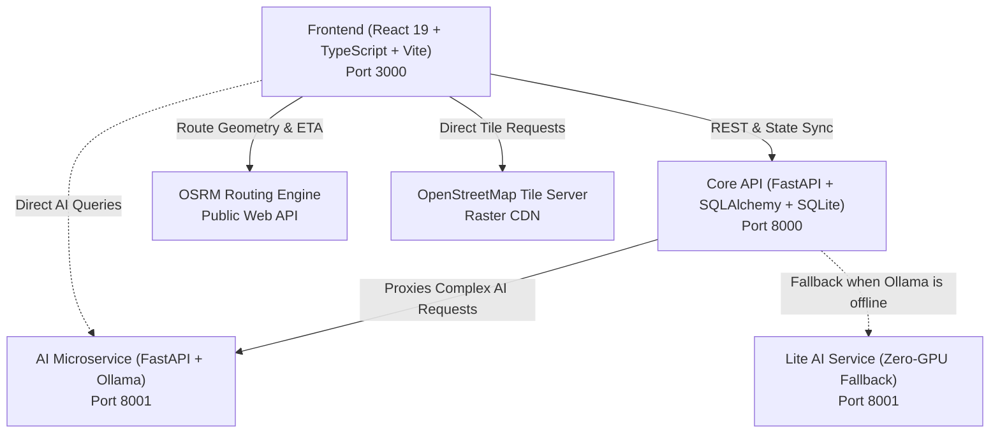

# JanSevak (PrajaPulse)

**An AI-powered, multi-stakeholder civic engagement and municipal intelligence platform connecting Citizens, NGOs, and Municipal Authorities.**

---

## Table of Contents

1. [Platform Overview](#platform-overview)
2. [System Architecture & Technology Stack](#system-architecture--technology-stack)
3. [Comprehensive Feature Catalog](#comprehensive-feature-catalog)
   - [1. Main Civic Feed & Issue Tracking](#1-main-civic-feed--issue-tracking)
   - [2. 7:00 AM Daily City Briefing ("Priority Redressal of the Day")](#2-700-am-daily-city-briefing-priority-redressal-of-the-day)
   - [3. Interactive In-App Navigation & Mapping](#3-interactive-in-app-navigation--mapping)
   - [4. AI-Powered Issue Reporting & Photo Analysis](#4-ai-powered-issue-reporting--photo-analysis)
   - [5. Positive Impact Reels & AI Verification](#5-positive-impact-reels--ai-verification)
   - [6. JanSevak Civic Learning Academy](#6-jansevak-civic-learning-academy)
   - [7. Volunteer Hub & NGO Studio](#7-volunteer-hub--ngo-studio)
   - [8. Predictive Civic Alerts & Street Risk Engine](#8-predictive-civic-alerts--street-risk-engine)
   - [9. Gamification, Points & Verified Certificates](#9-gamification-points--verified-certificates)
   - [10. Multi-Lingual Civic AI Assistant ("PrajaPulse AI")](#10-multi-lingual-civic-ai-assistant-prajapulse-ai)
   - [11. Civic Analytics & Municipal Governance](#11-civic-analytics--municipal-governance)
4. [Roles & Permissions Matrix](#roles--permissions-matrix)
5. [Quick Start & Installation Guide](#quick-start--installation-guide)
6. [Demo Accounts & Evaluation Credentials](#demo-accounts--evaluation-credentials)
7. [Verification & Test Suite](#verification--test-suite)

---

## Platform Overview

JanSevak transforms everyday citizen grievances into actionable municipal intelligence. It replaces slow, opaque bureaucratic complaint processes with a transparent, social-first civic portal backed by localized artificial intelligence.

Citizens can report local infrastructure failures with photos and GPS coordinates, track their lifecycle from submission to verified resolution, coordinate with local NGOs for volunteer cleanup drives, and earn recognized civic credentials. Municipal officials receive prioritized feeds sorted by urgency and real risk, while local NGOs can publish volunteer opportunities and certified educational courses.

---

## System Architecture & Technology Stack

JanSevak is built as a modular multi-tier application composed of three distinct services:



### 1. Frontend Client (`frontend/`)
- **Core Framework**: React 19, TypeScript 7, Vite 8
- **Styling**: Tailwind CSS 4 with custom dark themes, glassmorphism, and responsive mobile-first layouts
- **Animation Engine**: `motion/react` (Framer Motion) for spring physics, card stacks, and modal transitions
- **Mapping Engine**: Leaflet 1.9 with standard OpenStreetMap raster tiles, custom SVG pulsing markers, and CSS dark-mode filtering
- **Iconography**: Lucide React (vector icon suite)
- **State Management**: Centralized React Context (`AppContext`) with persistent browser caching for user preferences, bookmarks, and acknowledgment lifecycles

### 2. Core API (`backend/core_api/`)
- **Framework**: FastAPI (Python 3.10+)
- **Database & ORM**: SQLite with SQLAlchemy 2.0 (configured for ACID compliance and write-ahead logging)
- **Authentication**: JWT Bearer token authentication with bcrypt password hashing
- **Data Schemas**: Pydantic v2 validation models
- **Test Suite**: Pytest test suite covering authentication, issue lifecycle, rewards engine, and academy flows (75 passing tests)

### 3. AI Service (`backend/ai_service/`) & Lite Fallback (`backend/lite/`)
- **LLM Backbone**: Ollama running `llama3.2:3b` for conversational reasoning and text generation
- **Vision Model**: `llava` for multi-modal civic image analysis and scene verification
- **Civic Datasets**: Local CSV models for rainfall records, stormwater drainage networks, door-to-door waste collection, and municipal equipment allocation
- **Zero-GPU Fallback**: Autonomous lightweight FastAPI service (`backend/lite/`) with heuristic fallback rules, regex parsers, and mock inference engines, ensuring the application operates even on devices without dedicated GPUs or Ollama

---

## Comprehensive Feature Catalog

### 1. Main Civic Feed & Issue Tracking

- **Category Filtering**: Instant multi-category tabs: *Roads*, *Water*, *Sanitation*, *Streetlights*, *Public Safety*, *Parks*, and *Community*.
- **AI Criticality Sorting**: Toggleable **"Critical First (AI)"** switch that calls `/api/feed/prioritize` to rank issues based on severity, public hazard, and social impact rather than simple chronological order.
- **Media Carousel**:
  - Horizontal swipeable photo carousel supporting up to 5 high-resolution images per post.
  - Touch-drag and mouse swipe handlers with smooth snap transitions.
  - Photo counter badge (e.g. `1/3`) and indicator pagination pills.
  - Image fallback gradient rendering to prevent broken image placeholders.
- **Citizen Endorsement & Upvoting**:
  - One-tap upvote button with active state styling.
  - Live vote counter updates with optimistic UI reflections.
  - Full list of endorsing citizens viewable via the **Supporters Modal**.
- **Community Discussion Threads**:
  - Threaded comment section with real-time comment authoring.
  - Preview snippet on post cards showing the latest citizen commentary.
- **Lifecycle Status & Timeline**:
  - Official four-stage grievance tracking: **Reported** &rarr; **Under Review** &rarr; **In Progress** &rarr; **Resolved**.
  - Animated status badges with distinct visual cues.
  - Timeline history component displaying exact timestamps and official municipal notes for every stage transition.
- **Resolution Verification & Evidence Upload**:
  - Dedicated **Evidence Upload** drawer allowing neighbors to submit follow-up photos confirming work in progress or lingering issues.
  - **Resolution Card** displaying official "After" completion photos alongside the original report.
- **Department Escalation & Helpline Directory**:
  - In-app **Department Modal** displaying responsible municipal authority (e.g. *Roads & Infrastructure Department*, *Solid Waste Management Division*).
  - Expected SLA resolution timeframes, official helpline numbers, and direct contact buttons.

---

### 2. 7:00 AM Daily City Briefing ("Priority Redressal of the Day")

- **Time-Gated Morning Delivery**: Activates automatically after 7:00 AM local time to brief citizens on the top 3 most critical civic emergencies in their area.
- **3D Stacked Flashcard Carousel**:
  - Interactive physical flashcard stack with perspective 3D depth and subtle scale shadows.
  - Upward swipe or button gesture triggers a smooth dismissal animation where the top card slides back and the next urgent priority pops forward.
  - Each card displays high-resolution photo evidence, ward tag, issue title, severity indicator, and community endorsement counts.
- **Per-User Acknowledgment Lifecycle**:
  - Independent persistent tracking keyed by individual `userId` and calendar date string (`YYYY-MM-DD`).
  - When User A acknowledges the briefing, it disappears from their home screen, but remains completely visible and unread for User B on the same device until they acknowledge it.
- **Menu Screen Archive**:
  - Once dismissed from the home feed banner, the Daily Briefing is archived into the **Menu Drawer** for convenient recall throughout the day.
  - If a citizen has not yet acknowledged the morning briefing, the menu link remains locked with a notification indicator directing them to the home feed banner.

---

### 3. Interactive In-App Navigation & Mapping

- **100% Open-Source Mapping (No API Keys)**:
  - Powered by Leaflet and official OpenStreetMap raster tiles.
  - Eliminates external proprietary map redirects, proprietary billing, and API watermarks.
- **Problem Location Pin**:
  - Custom HTML marker featuring animated double pulsing red rings (`pulse-ring` and `pulse-ring-delayed`).
  - Clickable popup with report title, category badge, and exact ward address.
- **User GPS Pin**:
  - Integrated browser geolocation (`navigator.geolocation`) rendering a glowing blue GPS dot at the citizen's current coordinates.
  - Floating **Locate Me** button to instantly re-center the map on the user.
- **Live Driving Route & Glow Polyline (OSRM Engine)**:
  - Queries the public Open Source Routing Machine (OSRM) driving API to calculate the optimal driving route between user and problem location.
  - Renders dual-layer polylines: an ambient 10px blue blur glow underneath a crisp 4.5px navigation line.
  - Auto-fits map viewport bounds (`map.fitBounds`) with responsive padding so user, route, and destination are simultaneously framed.
- **Ola / Rapido Style Glassmorphic Navigation Sheet**:
  - Modern bottom sheet card (`bg-white/95 backdrop-blur-xl rounded-t-3xl`) with grab handle.
  - Live distance and estimated travel time badges (e.g. `2.4 km • 8 mins`, `Fastest Route`).
  - GPS coordinate pill with one-touch clipboard copy (`12.97840° N, 77.64080° E`).
  - **Start Turn-by-Turn** primary action button linking directly to navigation.
  - Quick action floating buttons: **Fit Route**, **Focus Pin**, **Zoom In (+)**, and **Zoom Out (−)**.
- **Instant Style Switcher**:
  - Toggle button between **OpenStreetMap Standard** and **High-Contrast Dark Mode** (realized via hardware-accelerated CSS tile filters).

---

### 4. AI-Powered Issue Reporting & Photo Analysis

- **Auto-Draft from Photo**:
  - Uploading a photo triggers vision model inference (`POST /api/complaint/prepare-with-image`).
  - Pre-fills the report title, structured description, suggested category, and severity rating automatically.
  - Displays a dismissible confirmation banner allowing citizens to edit or refine the pre-filled fields.
- **"Draft with AI" Description Polishing**:
  - Converts rough, shorthand, or Hinglish citizen notes (e.g. *"road pe big hole h near school bachhe gir rahe h"*) into formal, articulate civic petitions ready for municipal review.
  - Keeps outputs concise, professional, and within 100 words.
- **Photo Relevance Verification**:
  - Vision classifier (`POST /api/photo/verify`) inspects uploaded media to ensure it portrays genuine public infrastructure failures.
  - Rejects irrelevant media such as selfies, food photographs, pets, indoor rooms, or internet memes before submission.
- **Interactive GPS Map Picker**:
  - Dedicated pin dropper modal allowing citizens to drag and drop an exact coordinate pin on the map if they are reporting an issue from a different location.
- **Formal Complaint Letter Generator**:
  - AI engine (`POST /api/complaint/generate`) produces formal administrative letters addressed to the appropriate municipal commissioner, citing relevant municipal bylaws.

---

### 5. Positive Impact Reels & AI Verification

- **Before & After Transformation Reels**:
  - Visual storytelling feed showcasing civic grievances transformed into completed public works.
  - Interactive Before/After slider and side-by-side split screen.
  - Support for multi-photo comparisons and video walk-throughs.
- **AI-Powered Reel Verifier**:
  - Dedicated multi-factor verification module (`POST /api/impact/verify`).
  - **Physical Scene Matching**: Compares background architecture, pavement edges, road geometry, and landmarks to confirm both photos depict the *identical geographical location*.
  - **Civic Niche Classifier**: Flags and filters out unrelated content (e.g. cooking reels, dance videos, commercial ads).
  - **Impact Tiering**: Categorizes verified civic actions into *High Impact* (mass cleanups, structural repairs), *Moderate Impact*, and *Routine Maintenance*.
- **Transparent AI Audit Sheet (`ReelImpactAuditSheet`)**:
  - Accessible on any reel card to provide transparent AI reasoning.
  - Displays location match confidence percentage, detected civic category, impact tier score, and a written justification explaining the assessment.
- **Verified Resolver Flow**:
  - When closing a ticket via `ResolveModal`, submitting an "After" photo triggers automated AI verification to ensure the problem has actually been redressed before awarding points.

---

### 6. JanSevak Civic Learning Academy

- **Civic Course Directory (`AcademyScreen`)**:
  - Structured modules published by certified NGOs on waste management, water conservation, community composting, and public safety.
  - Category filters, total lesson counts, duration metrics, and earned points indicators.
- **Secure Video Player (`SecureVideo.tsx`)**:
  - Embedded player supporting MP4 and YouTube video streams.
  - Anti-skipping protection: prevents fast-forwarding past unwatched material.
  - Dynamic user-identity watermark overlay to prevent screen capture redistribution.
  - Auto-play next lesson upon video completion.
- **Interactive Lesson Quizzes (`LessonPanel.tsx`)**:
  - Inline multiple-choice knowledge checks after video lessons.
  - Instant answer validation with explanatory feedback.
  - Required quiz pass threshold before lesson completion credit is granted.
- **Cryptographic Certificate Generator & Modal**:
  - Completing all lessons in a course generates an official digital certificate.
  - Features student name, issuing NGO seal, course title, issuance date, and unique cryptographic **Certificate Code**.
  - One-click PDF download and social share options.
- **Public Certificate Verification Page (`/verify-certificate/:code`)**:
  - Publicly accessible verification portal where employers, universities, or municipal bodies can input a certificate code to verify its authenticity and completion record.

---

### 7. Volunteer Hub & NGO Studio

- **NGO Studio (`NgoStudioScreen`)**:
  - Dedicated dashboard for accredited NGOs to manage their civic footprint.
  - Course creation wizard with lesson video link attachments and quiz builders.
  - Volunteer vacancy creator with skill tags, ward assignment, and headcount quotas.
- **Campaign Board & Community Drives**:
  - Citizen volunteer drives linked directly to unresolved feed issues (e.g. *"Indiranagar Pothole Barricade & Tree Planting Drive"*).
  - Event scheduling, meeting point directions, volunteer roster, and progress tracker.
- **Volunteer Vacancy Board (`VacancyBoard.tsx`)**:
  - Browse openings posted by verified NGOs (e.g. *"Weekend Waste Auditor"*, *"Youth Tree Planter"*).
  - One-click volunteer application workflow with instant confirmation and status tracking.
- **Campaign Detail Sheet (`CampaignSheet.tsx`)**:
  - Slide-up bottom sheet with drive itinerary, required equipment checklist, organizer contact details, and participant lists.

---

### 8. Predictive Civic Alerts & Street Risk Engine

- **Seasonal Hazard Forecasting**:
  - Pre-monsoon waterlogging advisories, summer water scarcity alerts, and seasonal festival waste surge forecasts.
  - Synthesizes local municipal datasets covering rainfall statistics, drainage connection densities, and door-to-door collection metrics.
- **Street Risk Assessment Tool**:
  - Search bar in `PredictiveAlertsScreen` allowing citizens to query any street or neighborhood name.
  - AI engine calculates localized hazard risk level (*High*, *Moderate*, *Low*), probability percentage, and historical precedent.
- **Citizen Mitigation Checklists**:
  - Interactive seasonal action checklists (e.g. *"Clear rooftop drain spouts before June 1st"*).
  - Checking off completed mitigation tasks awards citizen reward points.

---

### 9. Gamification, Points & Verified Certificates

- **Civic Points Engine**:
  - Transparent point rewards for constructive community contributions:
    - Submitting a verified civic report: `+50 pts`
    - Endorsing/upvoting an issue: `+5 pts`
    - Uploading verified follow-up evidence: `+20 pts`
    - Completing an Academy course: `+100 pts`
    - Volunteering in a community drive: `+75 pts`
- **Citizen Rank Tiers**:
  - **Bronze Citizen** (`0 - 99 pts`)
  - **Silver Citizen** (`100 - 249 pts`)
  - **Gold Citizen** (`250 - 499 pts`)
  - **Platinum Citizen** (`500+ pts`)
- **Digital Badge Showcase**:
  - Earnable civic achievements including *Civic Starter*, *Watchdog*, *Green Crusader*, *Community Anchor*, and *Master Resolver*.
  - Rendered with custom artwork and milestone unlock requirements.
- **Municipal Perks & Rewards**:
  - Redeem civic points for municipal utility rebates, public transit passes, and civic event invitations.

---

### 10. Multi-Lingual Civic AI Assistant ("PrajaPulse AI")

- **Conversational Civic Support**:
  - Floating and fullscreen conversational assistant accessible across the platform.
  - Guides citizens through the grievance filing process, explains municipal bylaws, and provides contact info for municipal ward offices.
- **Multi-Lingual Natural Language Processing**:
  - Seamlessly understands and responds in **English**, **Hindi (हिंदी)**, and **Hinglish** (mixed Hindi-English), automatically matching the citizen's chosen language.
- **Conversational Memory**:
  - Retains multi-turn chat history for contextual troubleshooting and follow-up inquiries.
- **Hardened System Guardrails**:
  - Strict system prompt constraining responses to civic administration, municipal services, public health, and neighborhood welfare.

---

### 11. Civic Analytics & Municipal Governance

- **Ward-Wise Issue Heatmaps**:
  - Comparative analysis of grievances across municipal wards to identify neglected corridors.
- **Resolution SLA Monitoring**:
  - Tracks average resolution times per department (Roads, Water, Sanitation) against statutory municipal charters.
- **Category Breakdown & Trends**:
  - Visual metrics illustrating seasonal spikes in water supply failures, road damage, or streetlight outages.

---

## Roles & Permissions Matrix

| Capability / Feature | Citizen | NGO Leader | Municipal Official |
| :--- | :---: | :---: | :---: |
| Browse Public Feed, Map & Daily Briefing | Yes | Yes | Yes |
| Submit New Civic Reports & Photos | Yes | Yes | Yes |
| Endorse / Upvote Issues & Leave Comments | Yes | Yes | Yes |
| Upload Verification Evidence & Before/After Media | Yes | Yes | Yes |
| Enroll in Academy Courses & Earn Certificates | Yes | Yes | Yes |
| Apply for Volunteer Vacancies & Drives | Yes | Yes | Yes |
| Create & Lead Volunteer Campaigns | No | Yes | Yes |
| Publish Volunteer Vacancies & Manage Applicants | No | Yes | No |
| Author & Publish Academy Courses & Quizzes | No | Yes | No |
| Transition Issue Status (*In Progress*, *Resolved*) | No | No | Yes |
| Add Official Municipal Timeline Notes | No | No | Yes |
| Access Ward SLA & Department Analytics | Basic | Ward Level | Full City Admin |

---

## Quick Start & Installation Guide

### Prerequisites
- **Node.js** (v18.0 or newer) & **npm**
- **Python** (v3.10 or newer)
- **PowerShell** (Windows)
- **Ollama** *(Optional)*: Needed only for full local GPU model inference (`llama3.2:3b` and `llava`). If Ollama is not installed, the platform automatically routes AI queries through the built-in zero-GPU Lite fallback service.

---

### Option A: One-Click Startup (Recommended)

From the project root directory, run:

```powershell
.\run.bat
```

This single launcher script will automatically:
1. Initialize the SQLite database and verify all migrations.
2. Start the **Core API** backend on <http://localhost:8000>.
3. Detect Ollama and start either the **Full AI Service** or **Lite AI Fallback** on <http://localhost:8001>.
4. Start the **React Vite Frontend** on <http://localhost:3000>.
5. Open your default web browser directly to the JanSevak platform.
6. Pressing **Enter** in the console cleanly terminates all three services.

---

### Option B: Manual Service-by-Service Startup

#### 1. Core API Backend (`Port 8000`)
```powershell
cd backend\core_api
python -m venv .venv
.\.venv\Scripts\Activate.ps1
pip install -r requirements.txt
copy .env.example .env
python seed_data.py --reset
python -m uvicorn app.main:app --host 0.0.0.0 --port 8000 --reload
```
*API documentation and Swagger UI available at:* <http://localhost:8000/docs>

#### 2. AI Microservice (`Port 8001`)
**With Ollama (Full GPU Acceleration):**
```powershell
ollama pull llama3.2:3b
ollama pull llava
cd backend\ai_service
python -m venv .venv
.\.venv\Scripts\Activate.ps1
pip install -r requirements.txt
python -m uvicorn app.main:app --host 0.0.0.0 --port 8001 --reload
```

**Without Ollama (Zero-GPU Fallback):**
```powershell
cd backend\lite
python -m venv .venv
.\.venv\Scripts\Activate.ps1
pip install -r requirements.txt
python -m uvicorn app.main:app --host 0.0.0.0 --port 8001 --reload
```

#### 3. Frontend Web Application (`Port 3000`)
```powershell
cd frontend
npm install
npm run dev
```
*Web application available at:* <http://localhost:3000>

---

## Demo Accounts & Evaluation Credentials

Run `python seed_data.py --reset` in `backend/core_api/` to populate pre-configured test profiles. All demo accounts use the password: `demo123`.

| Email Address | Role | Tier & Points | Primary Purpose / What to Test |
| :--- | :--- | :--- | :--- |
| `ayush@example.com` | Citizen | Gold (340 pts) | Standard citizen reporting, upvoting, map navigation, and independent 7 AM briefing acknowledgment. |
| `priya@example.com` | Citizen | Silver (180 pts) | Secondary citizen account to test that acknowledging a briefing on Ayush's account leaves Priya's briefing intact. |
| `rahul@example.com` | Citizen | Bronze (40 pts) | Enrolling in academy courses, taking quizzes, and claiming verified certificates. |
| `official@example.com` | Municipal Official | N/A | Reviewing reported complaints, transitioning statuses (*Under Review* &rarr; *In Progress* &rarr; *Resolved*), adding official notes. |
| `ngo@example.com` | NGO Leader | N/A | Accessing **NGO Studio**, publishing new courses, creating volunteer vacancies, and organizing drives. |

---

## Verification & Test Suite

### Frontend Build & Type Validation
```powershell
cd frontend
npm run lint    # Runs tsc --noEmit (0 TypeScript errors)
npm run build   # Validates production Vite compilation
```

### Core API Pytest Suite
```powershell
cd backend\core_api
python -m pytest tests -q
```
*Current test suite status:* **75 passed, 0 failures**.

---

**JanSevak (PrajaPulse) — Empowering Citizens. Accelerating Governance. Driving Real Community Impact.**
