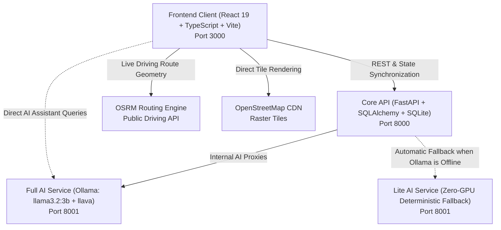

# JanSevak (PrajaPulse)

**An AI-powered, multi-stakeholder civic engagement and municipal intelligence platform connecting Citizens, NGOs, and Municipal Authorities.**

---

## Table of Contents

1. [Executive Overview & Vision](#executive-overview--vision)
2. [System Architecture & Technology Stack](#system-architecture--technology-stack)
3. [Exhaustive Feature Guide (With Detailed Explanations & Real-World Examples)](#exhaustive-feature-guide-with-detailed-explanations--real-world-examples)
   - [1. Main Civic Feed & Grievance Lifecycle](#1-main-civic-feed--grievance-lifecycle)
   - [2. 7:00 AM Daily City Briefing ("Priority Redressal of the Day")](#2-700-am-daily-city-briefing-priority-redressal-of-the-day)
   - [3. Interactive In-App Navigation & OpenStreetMap Routing](#3-interactive-in-app-navigation--openstreetmap-routing)
   - [4. AI-Powered Report Drafting & Computer Vision](#4-ai-powered-report-drafting--computer-vision)
   - [5. Positive Impact Reels & AI Transformation Verification](#5-positive-impact-reels--ai-transformation-verification)
   - [6. JanSevak Civic Learning Academy & Verified Certificates](#6-jansevak-civic-learning-academy--verified-certificates)
   - [7. Volunteer Hub & NGO Studio](#7-volunteer-hub--ngo-studio)
   - [8. Predictive Civic Alerts & Neighborhood Street Risk Engine](#8-predictive-civic-alerts--neighborhood-street-risk-engine)
   - [9. Gamification, Civic Points Ledger & Badge Portfolio](#9-gamification-civic-points-ledger--badge-portfolio)
   - [10. Multi-Lingual Civic AI Assistant ("PrajaPulse AI")](#10-multi-lingual-civic-ai-assistant-prajapulse-ai)
   - [11. Ward Analytics, SLAS & Municipal Accountability](#11-ward-analytics-slas--municipal-accountability)
4. [Roles & Permissions Matrix](#roles--permissions-matrix)
5. [Quick Start & Installation Guide](#quick-start--installation-guide)
6. [Demo Accounts & Evaluation Credentials](#demo-accounts--evaluation-credentials)
7. [Verification & Test Suite](#verification--test-suite)
8. [Supplementary Technical Documentation](#supplementary-technical-documentation)

---

## Executive Overview & Vision

In traditional municipal administration, civic complaint reporting is plagued by significant barriers:
- Citizens must navigate confusing departmental portals with complex jurisdiction boundaries.
- Complaints are frequently submitted with vague or emotional descriptions, lacking actionable technical details.
- Citizens receive little to no feedback once a ticket is created, leading to widespread civic apathy.
- Municipal engineers are overwhelmed by unsorted backlogs where life-threatening emergencies (e.g. exposed live cables, deep road craters) are buried under cosmetic issues (e.g. park bench repainting).
- Grassroots NGOs struggle to mobilize volunteers or deliver structured, certified civic education.

**JanSevak (PrajaPulse)** resolves these challenges by bridging the gap between citizens, non-governmental organizations, and municipal authorities through a unified, social-first platform backed by localized artificial intelligence.

---

## System Architecture & Technology Stack

JanSevak operates as a distributed, multi-service system designed for high availability and offline resilience:



### Technology Breakdown
- **Frontend**: React 19, TypeScript 7, Vite 8, Tailwind CSS 4, `motion/react` (Framer Motion), Leaflet 1.9, Lucide Icons.
- **Core API Backend**: FastAPI (Python 3.10+), SQLAlchemy 2.0, SQLite (WAL mode enabled), Pydantic v2 schemas, passlib bcrypt password security.
- **AI Microservice**: FastAPI, Ollama runtime (`llama3.2:3b` for conversational reasoning and text generation; `llava` for multi-modal vision analysis), pandas for civic dataset synthesis.
- **Lite AI Fallback**: Standalone zero-GPU fallback service (`backend/lite/`) utilizing deterministic heuristics and regex pattern matching, guaranteeing 100% platform uptime even without dedicated GPUs or Ollama.

---

## Exhaustive Feature Guide (With Detailed Explanations & Real-World Examples)

---

### 1. Main Civic Feed & Grievance Lifecycle

#### A. What Is This Feature?
The Main Civic Feed is the beating heart of JanSevak. It displays neighborhood grievances reported by verified citizens as dynamic, interactive social cards. Instead of hiding complaints in a private administrative database, reports are publicly visible to the entire community to foster transparency, prevent duplicate filings, and build collective endorsement for rapid resolution.

#### B. How It Works (Step-by-Step):
1. **Category Filter Tabs**: Citizens can filter the live feed by tapping any civic category: *Roads*, *Water*, *Sanitation*, *Streetlights*, *Public Safety*, *Parks*, and *Community*.
2. **AI Criticality Sort ("Critical First (AI)")**: A dedicated switch at the top of the feed allows citizens to toggle between standard chronological order and an AI-ranked urgency view. When activated, the backend analyzes complaint severity, physical hazard risk, and affected population, immediately surfacing life-threatening issues to the top.
3. **Multi-Photo Carousel**:
   - Each card supports up to 5 high-resolution photos.
   - Citizens can drag, swipe, or use left/right chevron buttons to inspect evidence.
   - Includes a floating photo index pill (e.g. `1/3`) and bottom pagination dots.
4. **Community Endorsements (Upvotes)**: Citizens can tap the **Thumbs Up** button to support a neighbor's grievance. Upvotes directly influence municipal escalation priority.
5. **Threaded Comments & Discussions**: Citizens and community leaders can comment, ask questions, or provide updates. Cards show a one-line preview of the latest comment.
6. **Status Timeline & Municipal Accountability**:
   - Clicking any post opens the comprehensive **Post Detail Modal**.
   - Displays a 4-stage visual tracker: **Reported** &rarr; **Under Review** &rarr; **In Progress** &rarr; **Resolved**.
   - Each step displays the exact date, time, and official municipal engineer notes (e.g. *"Work order #WO-402 issued to asphalt contractor"*).
7. **Citizen Evidence Upload**: Neighbors who visit the physical site can upload follow-up photos to verify whether work has begun or if a repair was inadequate.
8. **Department Escalation & SLA Modal**: Tapping the department badge reveals the assigned civic agency (e.g. *Roads & Infrastructure Department*), statutory resolution SLA (e.g. 48 hours), official helpline number, and commissioner email.

#### C. Real-World Walkthrough Example:
> **Scenario**: Priya walks past an open drainage manhole near 5th Cross, Ward 112. 
> 1. She opens JanSevak and spots a neighbor's existing report: *"Deep pothole & uncovered drain slab on 5th Cross"*.
> 2. Instead of filing a redundant report, Priya taps **Upvote (+5 pts)** and leaves a comment: *"Two school children tripped here yesterday evening, please fix urgently"*.
> 3. Other neighbors upvote the issue, bringing the endorsement count to 24.
> 4. When the BBMP Ward Officer logs in, the issue is highlighted in red at the top of their dashboard due to the high upvote count.
> 5. The officer dispatches a repair crew and updates the status to **In Progress** with a note: *"Concrete slab ordered, installation scheduled for 2:00 PM"*.
> 6. Priya and all supporters receive an instant notification update.

---

### 2. 7:00 AM Daily City Briefing ("Priority Redressal of the Day")

#### A. What Is This Feature?
A morning civic briefing that activates automatically at 7:00 AM local time. Inspired by daily news briefings, it aggregates the 24-hour civic feed, leverages AI prioritization, and presents citizens with the **Top 3 Most Critical Civic Emergencies** in their city that require immediate awareness or municipal action.

#### B. How It Works (Step-by-Step):
1. **Time-Gated Activation**: Built-in clock listeners check local time. The briefing banner unlocks at exactly 7:00 AM each morning.
2. **3D Stacked Physical Flashcards**:
   - The top 3 issues are rendered as physical cards stacked atop one another with subtle 3D perspective depth, rounded corners, and soft elevation shadows.
   - Each card displays the high-resolution photo evidence, severity badge (e.g. `Critical`), ward name, and headline.
   - Swiping upward or clicking the action button triggers a spring physics animation: the top card slides back and down, and the next priority pops into the foreground.
3. **Independent Per-User Acknowledgment Lifecycle**:
   - Acknowledgment is tracked independently by `userId` and calendar date (`YYYY-MM-DD`).
   - If Citizen A clicks **"Acknowledge"**, the briefing banner smoothly vanishes from their home screen.
   - If Citizen B logs in on the very same computer or browser, the briefing remains fully visible and unread until Citizen B acknowledges it themselves.
4. **Relocation to the Menu Screen**:
   - After acknowledgment, the briefing does not disappear forever—it moves into the **Menu Screen Drawer**.
   - Citizens can tap the Menu at 2:00 PM or 8:00 PM to review their morning briefing cards at any time.

#### C. Real-World Walkthrough Example:
> **Scenario**: Ayush opens JanSevak on his phone at 7:15 AM while having morning tea.
> 1. At the top of his feed, a glowing banner appears: *"7:00 AM City Briefing — Priority Redressal of the Day"*.
> 2. Card 1 shows: *"High-Voltage Cable Snapped across 12th Main Road"* with a bright red `Critical` badge.
> 3. Ayush swipes up: Card 2 pops forward, showing a major water pipeline breach flooding a residential lane.
> 4. Ayush swipes up again: Card 3 displays a fallen tree blocking a school bus route.
> 5. Ayush taps **"Acknowledge & Continue"**. The banner collapses, clearing his feed for regular browsing.
> 6. Ayush's sister Priya logs into her account on the same tablet later at 8:30 AM. Because the state is tracked per user account, Priya is greeted with her own 7:00 AM Briefing cards to review.

---

### 3. Interactive In-App Navigation & OpenStreetMap Routing

#### A. What Is This Feature?
A fully integrated, in-app navigation and mapping experience built on Leaflet and OpenStreetMap. It replaces annoying external Google Maps redirects with a smooth, native interface inspired by ride-hailing apps like Ola and Rapido. It requires **zero third-party API keys** and operates with zero watermarks or commercial limits.

#### B. How It Works (Step-by-Step):
1. **Interactive Pin Launcher**: Tapping the map pin icon on any feed post card or within the post detail modal immediately opens the full-screen map modal (`IssueMapView.tsx`).
2. **Pulsing Problem Pin**: Renders an animated custom HTML pin at the problem's GPS coordinates. Double pulsing concentric rings (`pulse-ring` and `pulse-ring-delayed`) pulse outward from the marker to make the problem location unmistakable.
3. **Live User GPS Dot**: Requests browser geolocation (`navigator.geolocation`) and places a pulsing blue GPS dot at the user's current location.
4. **Live Driving Route & Glow Polyline (OSRM Engine)**:
   - Queries the public Open Source Routing Machine (OSRM) driving API (`router.project-osrm.org`) using the user's coordinates and the issue coordinates.
   - Draws a glowing dual-layer blue polyline: a 10px wide semi-transparent ambient glow underneath a crisp 4.5px blue core line.
   - Uses `map.fitBounds` with padding to ensure the citizen's location, the route, and the civic issue are framed in a single view.
5. **Ola / Rapido Glassmorphic Bottom Sheet**:
   - A slide-in bottom card (`bg-white/95 backdrop-blur-xl rounded-t-3xl`) displays:
     - **Distance & Duration Badge**: e.g. `330.3 km • 4h 36m` (or `1.2 km • 5 mins` for local issues) along with a green `Fastest Route` tag.
     - **Issue Title & Ward Address**: Full textual description of the location.
     - **GPS Coordinate Pill**: Monospace display (`12.97840° N, 77.64080° E`) with a one-tap **Copy** button.
     - **Start Turn-by-Turn Navigation**: Direct button linking to native turn-by-turn driving directions.
6. **Floating Quick Controls**:
   - **Fit Route**: Re-centers and fits both pins and the complete route line.
   - **Locate Me**: Smoothly pans and flies directly to the user's GPS coordinates.
   - **Focus Pin**: Pans directly to the civic issue marker.
   - **Style Switcher**: One-tap toggle between **OpenStreetMap Standard** and **High-Contrast Dark Mode** (powered by CSS tile inversion, completely free of CartoDB watermarks).

#### C. Real-World Walkthrough Example:
> **Scenario**: An NGO volunteer wants to visit a reported illegal garbage dump site to organize a cleanup crew.
> 1. He taps the map pin button on the feed post.
> 2. The dark-themed map opens instantly with no redirects.
> 3. A blue dot pulses at his current office location, while a red marker pulses 1.8 km away at the dump site.
> 4. A glowing blue route line curves through the street grid connecting the two points.
> 5. The bottom sheet displays: `1.8 km • 7 mins (Fastest Route)`.
> 6. He taps the coordinate copy button to paste the exact latitude/longitude into his NGO field group chat, then taps **"Start Turn-by-Turn"** to drive to the location.

---

### 4. AI-Powered Report Drafting & Computer Vision

#### A. What Is This Feature?
A suite of multi-modal vision and language models that make reporting effortless, fast, and accessible to citizens of all literacy levels. It eliminates the frustration of filling out long, tedious municipal forms.

#### B. The 4 Sub-Features in Action:

1. **Auto-Draft Complaint from Photo (`llava` Vision Model)**:
   - *How it works*: When a user selects a photo from their phone camera or gallery, the image is compressed and sent to the vision model (`POST /api/complaint/prepare-with-image`).
   - *Output*: The model automatically inspects the image, infers the civic defect, and pre-fills the **Title**, **Description**, **Category**, and **Severity** rating.
   - *Example*: Citizen uploads a photo of water bubbling out of a cracked road. Within 2 seconds, the form is populated with Title: *"Drinking water pipeline rupture causing roadway flooding"*, Category: `Water`, Priority: `Critical`.

2. **"Draft with AI" Description Polisher (`llama3.2:3b`)**:
   - *How it works*: Citizens often write in broken English, colloquial slang, or emotional shorthand. Tapping the **"Draft with AI"** sparkles button sends their rough text to `POST /api/problem-description`.
   - *Example*:
     - *Citizen input*: `"road pe bahut bada gaddha h barish ka paani bhar gya h scooty wale gir rhe h plz jaldi dekho"`
     - *AI polished output*: `"A deep pothole on the roadway has become filled with stagnant rainwater, obscuring its depth and causing two-wheeler riders to lose control and fall. Immediate asphalt filling and drainage clearance are required to prevent severe accidents."`

3. **Photo Relevance & Spam Verifier (`llava`)**:
   - *How it works*: Filters out trolling, memes, private indoor photos, food, and selfies before they pollute the municipal dashboard (`POST /api/photo/verify`).
   - *Example*: If someone accidentally selects a photo of their lunch or a movie meme, the system flags `is_civic_issue: false` with reason: *"Image portrays indoor food items rather than public infrastructure damage"* and blocks submission.

4. **Formal Administrative Complaint Letter Generator (`llama3.2:3b`)**:
   - *How it works*: For grievances requiring formal escalation, tapping **"Generate Official Letter"** produces a legal-grade administrative representation addressed to the Ward Commissioner, citing citizen rights under municipal municipal charters and requesting an inspection within 7 working days.

---

### 5. Positive Impact Reels & AI Transformation Verification

#### A. What Is This Feature?
A social video and image story feed that celebrates positive civic change. When an issue is resolved, citizens and municipal workers post "Before & After" stories. To ensure accountability and prevent false claims of resolution, JanSevak uses an **AI Impact Verifier** that inspects both photos to verify that the transformation is genuine and impactful.

#### B. How It Works (Step-by-Step):
1. **Interactive Before/After Sliders**: Users can drag a vertical slider divider back and forth across the image to see the filthy or broken state wipe away into the clean, restored state.
2. **AI Physical Scene Matching**:
   - Compares the "Before" photo against the "After" photo.
   - Detects invariant background features: building facades, curb angles, electrical poles, compound wall patterns, and tree trunks.
   - Confirms whether both pictures were taken at the exact same physical spot, preventing unscrupulous contractors from submitting photos of a different, already-clean street.
3. **Civic Niche Classifier**:
   - Ensures the reel portrays genuine public service. Rejects irrelevant content such as cooking recipes, dance clips, or private home decor.
4. **Impact Scoring & Tier Classification**:
   - The AI assigns a composite score ($0 - 100$) and categorizes the reel into:
     - **High Impact**: Large-scale community cleanups, complete road resurfacing, major park restorations.
     - **Moderate Impact**: Pothole patch repairs, single streetlight fixture replacements.
     - **Routine Maintenance**: Standard street sweeping.
5. **Transparent AI Audit Sheet (`ReelImpactAuditSheet.tsx`)**:
   - Tapping the **AI Audit** badge opens a transparent breakdown displaying:
     - Physical Location Match Confidence (e.g. `92% Match`).
     - Transformation Category (e.g. `Sanitation`).
     - Impact Score (e.g. `86/100 • High Impact`).
     - AI Reasoning: *"Before image shows severe commercial waste overflow across 15 meters of pedestrian footpath. After image confirms complete debris removal, sidewalk pressure washing, and installation of dual segregation waste bins. Background compound wall and utility pole match precisely."*

---

### 6. JanSevak Civic Learning Academy & Verified Certificates

#### A. What Is This Feature?
An educational portal that trains citizens in civic literacy, environmental sustainability, waste segregation, and local governance bylaws. Courses are authored by accredited NGOs and award verifiable, tamper-evident digital certificates upon completion.

#### B. How It Works (Step-by-Step):
1. **Course Directory (`AcademyScreen.tsx`)**:
   - Browse multimedia courses (e.g. *"Urban Solid Waste Segregation Masterclass"*, *"Rainwater Harvesting & Groundwater Recharge"*).
   - Shows lesson counts, duration, and reward points upon completion (e.g. `+100 pts`).
2. **Secure Video Player (`SecureVideo.tsx`)**:
   - Supports self-hosted MP4 and YouTube video instruction.
   - **Anti-Skipping Enforcement**: Disables forward-seeking until the video has been watched in sequence.
   - **Dynamic Identity Watermark**: Overlays the logged-in student's email and timestamp across the video to deter unauthorized screen-recording or account sharing.
3. **Interactive End-of-Lesson Quizzes (`LessonPanel.tsx`)**:
   - Each lesson concludes with multiple-choice comprehension questions.
   - Explanations are provided for correct and incorrect answers.
   - Students must achieve a passing score to mark the lesson completed.
4. **Cryptographic Certificate Generation**:
   - Completing all lessons generates an official certificate of completion.
   - Contains student name, course title, issuing NGO badge, date of issuance, and a unique cryptographic **Certificate Code** (e.g. `CERT-JS-2026-9812`).
   - Includes a scannable verification QR code.
5. **Public Verification Portal (`CertificateVerifyScreen.tsx`)**:
   - Anyone (employers, university admissions, municipal bodies) can visit `/verify-certificate/:code` to verify that the certificate is authentic, untampered, and registered in the database.

---

### 7. Volunteer Hub & NGO Studio

#### A. What Is This Feature?
A collaborative coordination hub where non-governmental organizations, student clubs, and civic volunteers organize on-the-ground action.

#### B. How It Works (Step-by-Step):
1. **NGO Studio (`NgoStudioScreen.tsx`)**:
   - Accredited NGO administrators have a dedicated management interface to publish educational courses, post volunteer vacancies, and schedule community drives.
2. **Volunteer Vacancy Board (`VacancyBoard.tsx`)**:
   - NGOs post open volunteer positions (e.g. *"Weekend Waste Auditor"*, *"Youth Tree Planting Coordinator"*).
   - Specifies required skills, time commitment, ward location, and available openings (e.g. `4 of 10 spots left`).
   - Citizens apply with a single tap. NGOs can review and approve volunteer rosters.
3. **Issue-Linked Community Drives (`IssueDrives.tsx`)**:
   - Drives are directly linked to unresolved reports from the civic feed.
   - Example: A persistent garbage blackspot reported on the feed can be converted into an official *"Saturday Community Desilting & Cleanup Drive"*.
4. **Campaign Sheets (`CampaignSheet.tsx`)**:
   - Displays event meeting points, required equipment checklists (gloves, masks, shovels), organizer contact details, and registered participant avatars.

---

### 8. Predictive Civic Alerts & Neighborhood Street Risk Engine

#### A. What Is This Feature?
A predictive engine that forecasts civic hazards *before* they occur. By combining meteorological seasons with 7 municipal datasets (covering rainfall records, stormwater drainage networks, sewage connections, and daily waste tonnage), it alerts citizens and authorities to emerging risks.

#### B. How It Works (Step-by-Step):
1. **Seasonal Forecast Cards (`PredictiveAlertsScreen.tsx`)**:
   - Forecasts season-specific infrastructure threats:
     - **Monsoon**: Waterlogging hotspots, drain siltation overflows, road cave-in risks.
     - **Summer**: Groundwater depletion zones, water tanker demand surges, heat stress corridors.
     - **Post-Monsoon**: Dengue vector breeding hazards in stagnant water catchments.
     - **Winter**: Smog traps and leaf burning air quality degradations.
   - Each card displays risk probability percentage ($0 - 100\%$), expected onset timeline, vulnerable wards, and historical precedent.
2. **Interactive Citizen Checklists**:
   - Step-by-step mitigation actions for households (e.g. *"Inspect rooftop rainwater downspout filter before June 15"*).
   - Checking off tasks awards citizen points.
3. **Neighborhood Street Risk Checker**:
   - Citizens can type any street or neighborhood name into the search bar.
   - The AI correlates the street name with ward drainage capacity and historical waterlogging data to return an instant risk assessment:
     - Risk Level: `High Risk (82% Probability)`
     - Predicted Hazard: *"Low-lying arterial intersection prone to 1.5-foot stormwater backflow during heavy downpours."*
     - Action Required: *"Municipal desilting of culvert 3B scheduled. Residents advised to avoid parking in basement bays during thunderstorm warnings."*

---

### 9. Gamification, Civic Points Ledger & Badge Portfolio

#### A. What Is This Feature?
A gamification architecture designed to cultivate sustained civic participation. It rewards helpful actions with points, rank tiers, digital achievement badges, and tangible municipal perks.

#### B. How It Works (Step-by-Step):
1. **Transparent Points Ledger**:
   - Reporting a verified civic issue: `+50 pts`
   - Endorsing / upvoting a neighbor's issue: `+5 pts`
   - Uploading valid follow-up resolution evidence: `+20 pts`
   - Completing an Academy course: `+100 pts`
   - Participating in an NGO volunteer drive: `+75 pts`
   - Checking off a seasonal mitigation item: `+10 pts`
2. **Citizen Rank Tiers**:
   - **Bronze Citizen**: `0 – 99 pts`
   - **Silver Citizen**: `100 – 249 pts`
   - **Gold Citizen**: `250 – 499 pts`
   - **Platinum Citizen**: `500+ pts`
3. **Digital Badge Portfolio (`BadgesCertificatesScreen.tsx`)**:
   - Collectible digital badges including:
     - *Civic Starter*: Awarded upon submitting first verified report.
     - *Watchdog*: Awarded for verifying 5 resolved community issues.
     - *Green Crusader*: Awarded for completing waste and composting masterclasses.
     - *Community Anchor*: Awarded for organizing 3 approved volunteer campaigns.
4. **Municipal Perks Redemption (`RewardsScreen.tsx`)**:
   - Citizens can redeem accrued points for civic utility bill discounts, public transit vouchers, or priority passes to municipal cultural events.

---

### 10. Multi-Lingual Civic AI Assistant ("PrajaPulse AI")

#### A. What Is This Feature?
A 24/7 in-app conversational assistant designed to answer citizen inquiries regarding local governance, complaint filing, municipal bylaws, and emergency services.

#### B. How It Works (Step-by-Step):
1. Accessible via the bottom navigation bar or floating chat bubble.
2. **Multi-Lingual Automatic Dialect Detection**:
   - Supports **English**, **Hindi (हिंदी)**, and **Hinglish** (mixed Hindi-English in Latin script).
   - Automatically detects the user's phrasing and replies in the identical language and tone.
   - *Example (English)*: *"How do I track my water connection complaint?"* &rarr; Gives precise step-by-step navigation instructions.
   - *Example (Hinglish)*: *"bhai road pe deep pothole h complaint kaise kare?"* &rarr; Replies in Hinglish explaining how to use the camera button, select the Roads category, and submit.
3. **Conversational Context Window**:
   - Remembers up to 10 prior chat messages, allowing natural multi-turn follow-up inquiries.
4. **Zero-GPU Fallback Protection**:
   - If the local Ollama LLM server is offline, the Lite AI engine takes over transparently, answering common civic questions using rule-based pattern matching.

---

### 11. Ward Analytics, SLAS & Municipal Accountability

#### A. What Is This Feature?
An administrative intelligence dashboard for municipal engineers, ward corporators, and citizen watchdog groups to monitor departmental responsiveness.

#### B. How It Works (Step-by-Step):
1. **Ward Comparison Heatmaps (`ReportAnalysisScreen.tsx`)**:
   - Highlights grievance concentrations across municipal wards to identify neglected corridors.
2. **Department SLA Compliance Trackers**:
   - Tracks resolution timelines against statutory charters:
     - Roads & Potholes: Standard SLA 48 hours.
     - Streetlight Replacement: Standard SLA 24 hours.
     - Water Pipeline Burst: Standard SLA 12 hours.
   - Issues approaching or exceeding SLA thresholds are flagged in bold red.
3. **Resolution Trend Charts**:
   - Visual metrics showing percentage of complaints redressed, in progress, or awaiting review over 30-day, 60-day, and 90-day intervals.

---

## Roles & Permissions Matrix

| Platform Capability | Citizen | NGO Leader | Municipal Official |
| :--- | :---: | :---: | :---: |
| Browse Live Feed, Interactive Map & Daily Briefing | Yes | Yes | Yes |
| Submit New Civic Reports & Photo Evidence | Yes | Yes | Yes |
| Upvote / Endorse Issues & Post Comments | Yes | Yes | Yes |
| Upload Follow-Up Resolution Evidence | Yes | Yes | Yes |
| Enroll in Academy Courses & Claim Certificates | Yes | Yes | Yes |
| Apply for Volunteer Vacancies & Attend Drives | Yes | Yes | Yes |
| Create & Lead Volunteer Campaigns | No | Yes | Yes |
| Author & Publish Academy Courses & Quizzes | No | Yes | No |
| Post Volunteer Vacancies & Review Applicants | No | Yes | No |
| Transition Issue Status (*In Progress*, *Resolved*) | No | No | Yes |
| Add Official Municipal Notes to Status Timeline | No | No | Yes |
| Access Ward-Level Department SLA Analytics | Basic | Ward Scope | Full Municipal Scope |

---

## Quick Start & Installation Guide

### Prerequisites
- **Node.js** (v18.0 or newer) & **npm**
- **Python** (v3.10 or newer)
- **PowerShell** (Windows)
- **Ollama** *(Optional)*: Needed only for full local GPU model inference (`llama3.2:3b` and `llava`). If Ollama is not installed, the platform automatically routes AI queries through the built-in zero-GPU Lite fallback service.

---

### Option A: One-Click Startup (Recommended)

From the project root directory, run:

```powershell
.\run.bat
```

This single launcher script will automatically:
1. Initialize the SQLite database and verify all migrations.
2. Start the **Core API** backend on <http://localhost:8000>.
3. Detect Ollama and start either the **Full AI Service** or **Lite AI Fallback** on <http://localhost:8001>.
4. Start the **React Vite Frontend** on <http://localhost:3000>.
5. Open your default web browser directly to the JanSevak platform.
6. Pressing **Enter** in the console cleanly terminates all three services.

---

### Option B: Manual Service-by-Service Startup

#### 1. Core API Backend (`Port 8000`)
```powershell
cd backend\core_api
python -m venv .venv
.\.venv\Scripts\Activate.ps1
pip install -r requirements.txt
copy .env.example .env
python seed_data.py --reset
python -m uvicorn app.main:app --host 0.0.0.0 --port 8000 --reload
```
*API documentation and Swagger UI available at:* <http://localhost:8000/docs>

#### 2. AI Microservice (`Port 8001`)
**With Ollama (Full GPU Acceleration):**
```powershell
ollama pull llama3.2:3b
ollama pull llava
cd backend\ai_service
python -m venv .venv
.\.venv\Scripts\Activate.ps1
pip install -r requirements.txt
python -m uvicorn app.main:app --host 0.0.0.0 --port 8001 --reload
```

**Without Ollama (Zero-GPU Fallback):**
```powershell
cd backend\lite
python -m venv .venv
.\.venv\Scripts\Activate.ps1
pip install -r requirements.txt
python -m uvicorn app.main:app --host 0.0.0.0 --port 8001 --reload
```

#### 3. Frontend Web Application (`Port 3000`)
```powershell
cd frontend
npm install
npm run dev
```
*Web application available at:* <http://localhost:3000>

---

## Demo Accounts & Evaluation Credentials

Run `python seed_data.py --reset` in `backend/core_api/` to populate pre-configured test profiles. All demo accounts use the password: `demo123`.

| Email Address | Role | Tier & Points | Primary Purpose / What to Test |
| :--- | :--- | :--- | :--- |
| `ayush@example.com` | Citizen | Gold (340 pts) | Standard citizen reporting, upvoting, map navigation, and independent 7 AM briefing acknowledgment. |
| `priya@example.com` | Citizen | Silver (180 pts) | Secondary citizen account to test that acknowledging a briefing on Ayush's account leaves Priya's briefing intact. |
| `rahul@example.com` | Citizen | Bronze (40 pts) | Enrolling in academy courses, taking quizzes, and claiming verified certificates. |
| `official@example.com` | Municipal Official | N/A | Reviewing reported complaints, transitioning statuses (*Under Review* &rarr; *In Progress* &rarr; *Resolved*), adding official notes. |
| `ngo@example.com` | NGO Leader | N/A | Accessing **NGO Studio**, publishing new courses, creating volunteer vacancies, and organizing drives. |

---

## Verification & Test Suite

### Frontend Build & Type Validation
```powershell
cd frontend
npm run lint    # Runs tsc --noEmit (0 TypeScript errors)
npm run build   # Validates production Vite compilation
```

### Core API Pytest Suite
```powershell
cd backend\core_api
python -m pytest tests -q
```
*Current test suite status:* **75 passed, 0 failures**.

---

## Supplementary Technical Documentation

- **[`AI_FEATURES.md`](./AI_FEATURES.md)**: Deep-dive technical reference on all 12 AI modules, vision pipelines, dataset math, and defensive prompt engineering.
- **[`backend/core_api/README.md`](./backend/core_api/README.md)**: Database schema specifications, ORM models, and Core API endpoints.
- **[`backend/ai_service/README.md`](./backend/ai_service/README.md)**: AI service architecture, Ollama model configs, and Vision tuning guidelines.

---

**JanSevak (PrajaPulse) — Empowering Citizens. Accelerating Governance. Driving Real Community Impact.**
